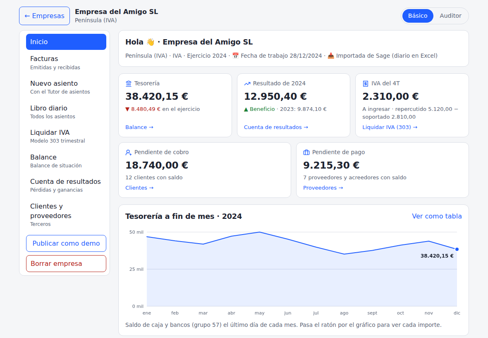
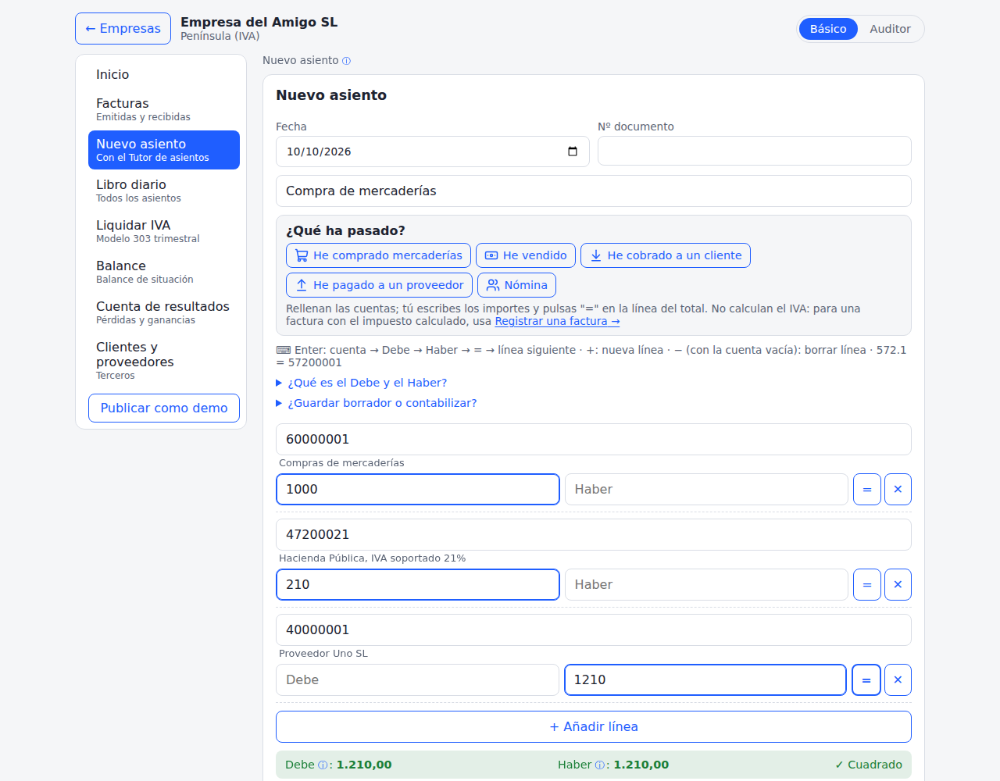
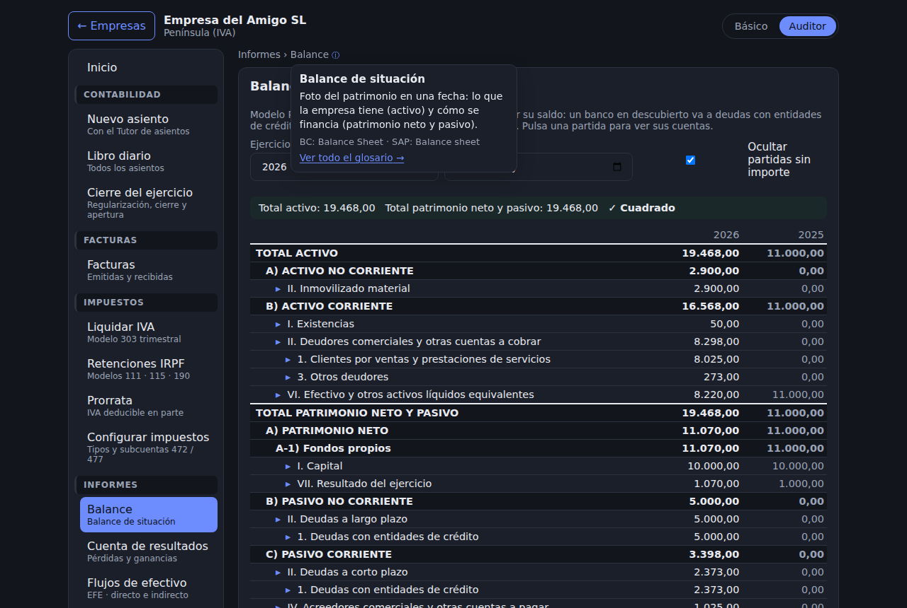
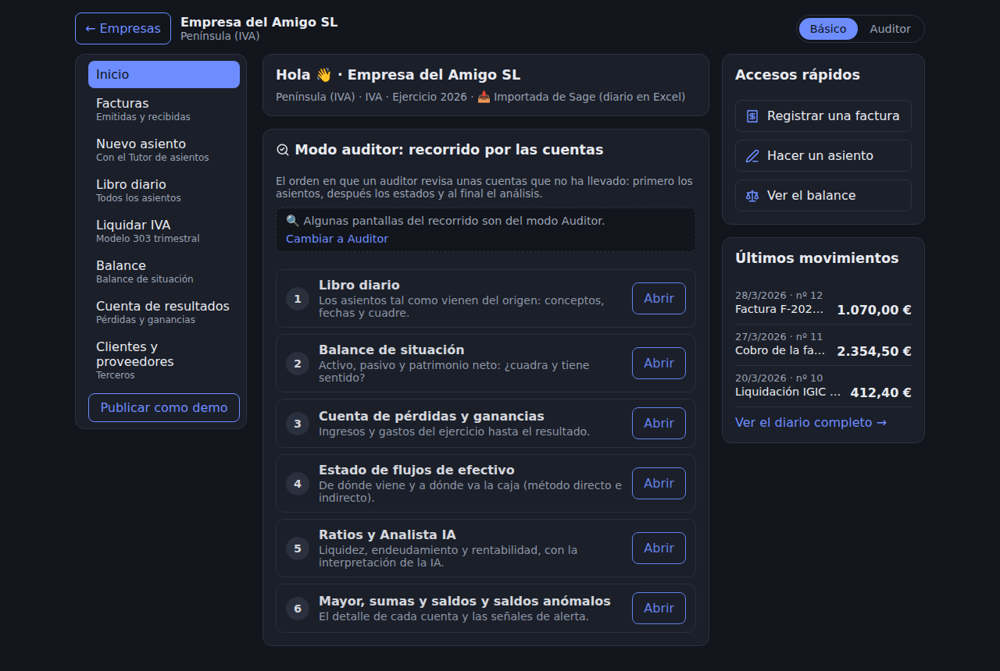

# Mini ERP · Contabilidad general española

[](https://github.com/Diosvely/MiniERP/actions/workflows/ci.yml)

**🔗 Demo en vivo:** [minierp-6ty.pages.dev/?demo](https://minierp-6ty.pages.dev/?demo). Entra como invitado,
**sin registrarte**, y consulta las empresas de ejemplo. O regístrate, crea tu empresa y contabiliza.

ERP web de **contabilidad general** para aprender contabilidad española (**PGC 2007, IVA e IGIC**) como lo haría
una gestoría. Cubre asientos, terceros, registro de facturas, liquidación trimestral, cierre del ejercicio, estados
financieros e informes de auditor. Además, importa contabilidades reales de otros ERP y añade **IA open source**
que interpreta los estados y propone asientos.
La estructura de datos se inspira en **Microsoft Dynamics 365 Business Central** y **SAP FI**. El registro de
facturas sigue a los ERP españoles (**A3, Sage, ContaPlus**), simplificado para que cada pieza se entienda.
Proyecto de aprendizaje en evolución.

> **English summary.** A web-based general ledger (mini ERP) built to learn Spanish accounting
> (Spanish GAAP – PGC 2007, VAT and Canary Islands IGIC). Features:
> - business partners and invoice registration with automatic VAT/IGIC, including withholdings, reverse charge,
>   equivalence surcharge and pro rata;
> - quarterly tax settlement (forms 303 / 420) and year-end closing;
> - balance sheet, income statement, cash flow statement (direct and indirect), financial ratios and audit reports;
> - an **auditor mode** that imports real journals from Sage and Business Central;
> - an open-source **AI analyst** and an **AI journal-entry tutor** whose proposals are validated by the ERP;
> - a guided home screen, a Basic / Auditor menu, plain-language error messages, journal-entry templates and an
>   in-app glossary with Business Central / SAP equivalents. Accessible: no axe-core issues (WCAG 2 A/AA);
> - an audit trail (ledger → journal entry → ledger of each account), a per-company work date, and fast reports
>   on real multi-year journals (tens of thousands of lines);
> - a home dashboard (cash, result, VAT, receivables, payables and month-end cash chart), comparative statements with
>   horizontal analysis, a cash-flow waterfall, ratio trends, and Excel export / print for every report.
>
> Data model inspired by Business Central and SAP FI. Database in English, bilingual UI (Spanish / English),
> multi-company and multi-user, with guest access to demo companies (CAPTCHA-protected). Accounting rules are enforced
> by PostgreSQL, security headers and a strict CSP protect the web, and every pull request is checked by CI
> (SQL tests, web unit tests, lint, build and dependency audit). Learning project, work in progress.

| Inicio con indicadores | Asiento con plantilla |
|---|---|
|  |  |
| **Balance (modo oscuro) con el glosario** | **Modo auditor de una empresa importada** |
|  |  |

Más capturas: [pantalla de entrada](docs/capturas/01-entrada.png) · [errores en lenguaje claro](docs/capturas/06-errores-claros.png) · [Inicio en el móvil](docs/capturas/07-inicio-movil.png) · [cascada del EFE](docs/capturas/08-efe-cascada.png) · [Balance comparativo](docs/capturas/09-balance-comparativo.png) · [libro mayor en el móvil](docs/capturas/10-mayor-movil.png) · [cobros y pagos](docs/capturas/11-cobros-pagos.png) · [comprobaciones](docs/capturas/12-comprobaciones.png) · [inmovilizado](docs/capturas/13-inmovilizado.png) · [ajustes de cierre](docs/capturas/14-ajustes-cierre.png) · [asistente de cierre](docs/capturas/15-asistente-cierre.png) · [nóminas](docs/capturas/16-nominas.png) · [modelos y fuentes](docs/capturas/17-modelos.png) · [practicar](docs/capturas/18-practicar.png)

---

## ¿Por qué este proyecto?

Después de más de 15 años en control de gestión y costes, al llegar a España necesitaba dominar la contabilidad
española y el funcionamiento real de un ERP. Los ERP comerciales son caros y difíciles de practicar por cuenta
propia, así que decidí **construir uno**. Diseñar la tabla de asientos obliga a entender *por qué* un ERP impone
cada regla. Además, todo el código está en inglés para practicar el vocabulario técnico de BC y SAP.

## ¿Qué hace hoy? (v0.40.0)

**Primeros pasos y navegación**
- **Pantalla de Inicio** en cada empresa:
  - **ruta guiada** "Tu primer trimestre, paso a paso" (impuestos → tercero → factura → diario → liquidación →
    balance). Los pasos se marcan solos al hacerlos.
  - en las empresas importadas y las demos, un **recorrido de auditor** por las cuentas.
  - **indicadores** a la fecha de trabajo: tesorería, resultado (frente al año anterior), IVA/IGIC del trimestre,
    pendiente de cobro y de pago, y la **tesorería a fin de mes** en un gráfico. Cada cifra lleva a su informe. Salen
    arriba en las empresas importadas y demos; en una empresa propia, cuando ya tiene lo básico (y la ruta se pliega
    al completarla).
- **Modo Básico / Auditor:** un menú corto en lenguaje sencillo para quien empieza (9 entradas) o el menú completo
  por áreas para revisar.
- **Cada pantalla tiene su enlace** (`#/empresa/<id>/balance`): se puede recargar, volver atrás y compartir.
- **Fecha de trabajo de cada empresa** (la *Work Date* de BC): hoy si la empresa está al día, o la de su último
  asiento si es histórica o importada. De ella salen el año de los informes, el trimestre de las liquidaciones, el
  "Desde" del diario y la fecha de los asientos y facturas nuevos.
- Estados vacíos con la **siguiente acción** ("Configurar impuestos", "Hacer un asiento") y aviso de carga.
- **Errores en lenguaje claro:** cuando la base de datos rechaza algo, se explica qué ha pasado, qué hacer y se ofrece
  un botón para ir a la pantalla donde se arregla ("El asiento no cuadra: falta 210,00; pulsa =").
- **Pantalla de entrada** con la demo destacada, y acceso y registro accesibles.
- **Glosario dentro de la app:** un ⓘ junto a cada pantalla y a los términos clave explica el concepto, con su nombre
  en Business Central y SAP. Hay también una página de glosario con buscador.
- **Accesible:** sin fallos con axe-core (WCAG 2 A/AA) en modo claro y oscuro, todo se usa con el teclado, el idioma
  de la página sigue al elegido y los colores tienen contraste suficiente.

**Contabilidad**
- **Plan General Contable 2007** (grupos 1-7) con nombre oficial y traducción al inglés, copiado automáticamente a
  cada empresa. **Subcuentas** validadas e **importación desde CSV** con vista previa.
- **Empresas** por sector y territorio fiscal: **Península → IVA** o **Canarias → IGIC**. Ejercicios con 12
  periodos.
- **Asientos** con cuadre en vivo, manejo rápido con teclado (atajo del punto `572.1 = 57200001`, botón "=" y
  deshacer) y numeración correlativa sin huecos.
- **Plantillas "¿Qué ha pasado?"** (compra, venta, cobro, pago, nómina) que rellenan las subcuentas, y **buscador de
  cuentas por nombre** ("caja", "bancos").
- **Inmutabilidad:** un asiento contabilizado no se edita ni se borra; se **anula con contraasiento** (con fecha y
  motivo), como *Reverse Transaction* de BC o la FB08 de SAP.
- **Cierre del ejercicio:** regularización a la 129, cierre, apertura y reapertura, con confirmación en dos pasos.

**Terceros, IVA/IGIC y facturas** (modelo gestoría)
- **Terceros** (clientes 430, proveedores 400, acreedores 410, deudores 440) con su propia subcuenta y
  **validación de NIF/NIE/CIF**.
- **Configuración de impuestos** por tipo (472 soportado / 477 repercutido), con asistente para IVA o IGIC.
- **Registro de facturas** recibidas y emitidas, normales y **rectificativas**, con asiento automático, vista
  previa y libro registro. La **regla del lado** aplica a devoluciones (608/708), rappels (609/709) y pronto pago
  (606/706).
- **Casos especiales:**
  - retenciones IRPF (modelos 111 / 115 / 190);
  - operaciones exentas, exportaciones e intracomunitarias;
  - **inversión del sujeto pasivo**;
  - **recargo de equivalencia**;
  - **prorrata general** con regularización anual.
- **Liquidación trimestral** (modelos **303 IVA / 420 IGIC**):
  - compensación de cuotas y devolución en el 4T;
  - cuadre *libro registro ↔ contabilidad*;
  - bloqueo del trimestre declarado.
- **Cobros y pagos contra la factura** (como la liquidación de BC o la compensación de partidas abiertas de SAP):
  se paga o se cobra una o varias facturas, entera o en parte, y el ERP hace el asiento. Los pagos hechos a mano se
  **vinculan** sin asiento nuevo. **Antigüedad de saldos** a una fecha, con el saldo contable al lado para detectar
  movimientos sin vincular. Días de pago del tercero, vencimiento y estado de cada factura.
- **Cuentas controladas** con un interruptor por empresa: **estricto** como SAP o Business Central (un asiento
  manual sobre la 410, la 430 o la 472 no se contabiliza: se registra desde su pantalla) o **guiado** como los ERP
  españoles (avisa antes y lo lista después). **Comprobaciones del auditor** a una fecha: IVA/IGIC frente al libro
  registro, retenciones frente al 111/115, terceros frente a sus facturas, saldos anómalos e impuesto del otro
  territorio, con cada caso enlazado y la pantalla donde se arregla. También señala la cuota de IVA/IGIC que no
  corresponde a base × tipo.
- **Invariantes contables** (cada asiento cuadra, Activo = PN + Pasivo, la 129 recibe el resultado, la apertura es el
  cierre, el libro registro coincide con la 472/477, la tesorería coincide con el EFE…), comprobados con cientos de
  operaciones al azar y cinco supuestos de referencia calculados desde la norma.
- **Inmovilizado**: ficha de cada activo (desde la factura recibida), cuadro de amortización lineal, asiento
  68x/28x hasta la fecha que elijas, baja o venta con su factura y resultado en 671/771, y aviso si se supera el
  máximo fiscal de la tabla del Impuesto sobre Sociedades (art. 12.1.a LIS). Las rectificativas de compra ajustan la ficha.
- **Ajustes de cierre**: periodificaciones (480 / 485 / 4009 / 4309) con su reversión, deterioro de clientes
  (694 / 490 / 794 y 650), provisiones (141 / 142 / 529 / 499 y 795), deterioro del inmovilizado (69x / 29x / 79x, con la
  amortización recalculada), inventario del cierre (61x / 71x y 39x) y un **asistente de cierre** con los diez pasos en
  orden, con los avisos fiscales del Impuesto sobre Sociedades (arts. 13.1 y 104 LIS).
- **Nóminas**: empleados ficticios, tipos de cotización del año (2026: Orden PJC/297/2026), recibo de salarios
  con la base de cotización y la prorrata de las pagas extra (art. 147 LGSS), asiento 640 / 642 contra 476 / 4751 / 465
  con las pagas devengadas cada mes, pago del líquido y de los seguros sociales, y el IRPF de las nóminas en el
  modelo 111 (casillas 01 a 03).
- **Modelos tributarios**: las casillas oficiales del 303 / 420 y de los resúmenes anuales 390 / 425, el 347
  (operaciones con terceros) y el 349 (operaciones intracomunitarias), desde el libro registro, cuadrados con las
  liquidaciones; cada modelo enseña sus **fuentes oficiales** (📘: instrucciones de la AEAT y la ATC y leyes del BOE).
- **Practicar** (🎓 en la cabecera): 14 supuestos prácticos (básico, intermedio y avanzado) que el ERP corrige
  línea a línea (cuenta por su grupo del PGC, lado e importe) explicando los errores frecuentes, con tu progreso, la
  solución, la norma (📘) y **dónde se registra** cada operación. El Tutor de asientos también dice dónde se
  registra, y «Evaluar la IA» le pasa los mismos supuestos para medir cuánto acierta.

**Estados financieros e informes (mirada de auditor)**
- **Balance de situación** y **cuenta de pérdidas y ganancias** (modelo PYMES del PGC), con desglose hasta la
  subcuenta y **análisis horizontal**: año anterior, variación en importe y en %. A mitad de ejercicio, la PyG se
  compara con el mismo periodo y el Balance con el cierre anterior (NIC 34).
- **Estado de flujos de efectivo** por el método **directo** y el **indirecto**, con el cuadre del auditor entre
  los dos, y una **cascada** que enseña de dónde viene y a dónde va el dinero del año.
- **Ratios:**
  - liquidez, solvencia, endeudamiento y rentabilidad;
  - periodos medios de cobro y de pago;
  - zonas de referencia y explicación de cada uno;
  - **evolución de cada ratio** en todos los ejercicios, con su zona de referencia sombreada.
- **Libro diario**, **sumas y saldos**, **libro mayor** y **saldos anómalos** (saldo contrario a su naturaleza y
  reclasificación al cierre).
- **Exportar a Excel** (importes como números y fechas como fechas, listos para una tabla dinámica o Power BI) e
  **imprimir / guardar en PDF** el Balance, la PyG, el EFE, sumas y saldos, el mayor y el diario.
- En el móvil, el mayor y sumas y saldos se ven como **tarjetas**, y las fechas van en formato dd/mm/aaaa.
- **Rastro contable:** el nº de asiento del mayor abre la **ficha del asiento**, y cada cuenta de la ficha (y del
  diario) abre su libro mayor; una anulación lleva a su pareja. Como el FBL3N → FB03 de SAP. "Volver" y el botón
  atrás deshacen el camino.
- **Rápido con contabilidades reales:** el mayor filtra antes de calcular el saldo (0,2 s con 120.000 apuntes) y
  las listas largas se leen por páginas, sin el corte de 1.000 filas de Supabase.

**Modo auditor: contabilidades reales**
- **Importación de diarios** de **Sage** (Excel) y **Business Central**: vista previa, creación de subcuentas,
  contabilización mes a mes y cierre de cada ejercicio.
- Las empresas importadas son privadas. Se publican como demo **solo si su titular lo decide**, con su mención y
  con datos anonimizados.
- **Borrar la empresa entera** (solo su admin): resumen de lo que se borra, confirmación escribiendo el nombre y
  progreso por tandas. Sirve para enseñar una importación y quitarla después. Una demo publicada no se puede borrar.

**Inteligencia artificial** (Cloudflare Workers AI, modelos open source)
- **Analista IA:** interpreta el balance, la PyG, el EFE y los ratios ya calculados (fortalezas, alertas y
  preguntas del auditor). Solo recibe **cifras agregadas**: nunca nombres de empresas, terceros ni conceptos.
- **Tutor de asientos:** describes una operación ("factura de la abogada de 1.000 € más IVA") y la IA propone el
  asiento.
  - **El ERP lo valida**: impuestos de nuestras tablas, subcuentas reales, normas de valoración y reglas de
    criterio.
  - **Retenciones con reglas de la base de datos:** la ficha del tercero (persona física o entidad, retención por
    defecto) manda, y el ERP calcula la retención y lo que queda a pagar (1.000 + 70 − 150 = 920). La IA clasifica;
    la base de datos contabiliza.
  - **Tú decides** si cargarlo en el formulario.
- Cuota diaria por usuario y **opiniones sobre cada respuesta** para mejorar la IA.

**Plataforma**
- **Roles al estilo Microsoft:**
  - **Administrador** (el propietario);
  - **Miembro**: el titular de los datos de una empresa importada, que trabaja en ella, usa la IA con cuota y
    decide si se publica como demo;
  - **Colaborador**: se registra y lleva sus empresas;
  - **Visor**: los invitados que ven las demos.
- **Multiusuario y multiempresa** con roles por empresa (admin, contable, lectura) mediante *Row Level Security*.
- **Empresas DEMO** de solo lectura y **acceso como invitado sin registro**.
- **Español / inglés** con selector de bandera, en móvil y en ordenador.
- **Uso de la web** solo para el propietario: visitantes de la demo, registros y activos por día, sin datos personales.

**Seguridad**
- **Cabeceras HTTP** con una CSP estricta (solo el propio dominio, Supabase y Cloudflare Turnstile), protección contra
  *clickjacking*, HSTS y `Permissions-Policy`.
- **CAPTCHA (Cloudflare Turnstile)** en la demo, el registro y el acceso. Los invitados de más de 7 días **se borran
  solos** cada noche (`pg_cron`).
- Las funciones de IA validan cada petición (UUID y tamaño) y nunca devuelven errores internos al navegador.
- La web solo usa la clave **publicable** de Supabase; quién puede ver o hacer cada cosa lo decide PostgreSQL (RLS).
- Solo el propietario nombra **titulares de los datos** (trigger en la base de datos, v0.29.1).
- **Dependabot** vigila las dependencias, y los fallos de seguridad se avisan en privado ([SECURITY.md](SECURITY.md)).
  La lista de ajustes del panel de Supabase está en [`docs/seguridad-supabase.md`](docs/seguridad-supabase.md).

## Arquitectura

| Capa | Tecnología | Notas |
|---|---|---|
| Base de datos | **PostgreSQL** en Supabase (schema `erp`) | Las reglas contables viven en la base de datos: triggers, funciones y RLS |
| Autenticación | Supabase Auth + **Cloudflare Turnstile** | Correo y contraseña · invitados con *anonymous sign-ins* · CAPTCHA |
| Web | **React + Vite** | Componentes por pantalla, i18n propio (es/en), rutas con almohadilla, iconos `lucide-react` |
| IA | **Cloudflare Workers AI** + Pages Functions | `/api/ai` (Mistral Small 3.1) y `/api/tutor` (gpt-oss-120b); la clave nunca llega al navegador |
| Despliegue | **Cloudflare Pages** | Despliegue automático desde `main`, dirección de prueba por rama y cabeceras de seguridad (`_headers`) |
| Calidad | **GitHub Actions** + **Vitest** + Dependabot | 50 pruebas SQL, 148 tests de la web, lint, build y auditoría de dependencias en cada Pull Request |
| Versionado | Git + GitHub | Ramas, Pull Requests, `main` protegida, versiones etiquetadas y decisiones documentadas (ADR) |

**Principio clave:** la web nunca es la única barrera. Aunque alguien manipule el navegador, PostgreSQL rechaza:
- un asiento descuadrado;
- una factura duplicada;
- una escritura en una empresa ajena o de un invitado;
- la edición de un asiento contabilizado;
- el uso de la IA sin permiso o por encima de la cuota.

## Modelo de datos (resumen)

| Tabla | Equivalente BC | Equivalente SAP |
|---|---|---|
| `companies` | Company | Company Code (BUKRS) |
| `fiscal_years` / `accounting_periods` | Accounting Periods | Fiscal Year / Posting Periods |
| `coa_template` / `gl_accounts` | G/L Account | Chart of Accounts (SKA1 / SKB1) |
| `business_partners` | Customer / Vendor | Business Partner |
| `tax_codes` / `tax_setup` | VAT Product Posting Group / VAT Posting Setup | Tax Code (MWSKZ) / OB40 |
| `journal_entries` / `journal_lines` | G/L Entries | BKPF / BSEG |
| `invoices` / `invoice_tax_lines` | Posted Purchase / Sales Invoices · VAT Entries | FB60 / FB70 · BSET |
| `tax_settlements` | Calc. and Post VAT Settlement | RFUMSV00 |
| `year_closings` | Close Income Statement | Saldos a cuenta nueva (F.16 / FAGLGVTR) |
| `import_batches` / `import_lines` | Configuration Packages / Data Migration | LSMW · Migration Cockpit |
| `cf_lines` / `cf_mapping` | Financial Reports (Cash Flow) | Cash Flow Statement (FS item mapping) |
| `ratio_defs` | Analysis Views / KPIs | Financial Statement Version · KPIs |
| `balance_rules` | — | — (regla de auditoría: naturaleza del saldo) |
| `company_users` / `app_profiles` / `ai_feedback` | Permission Sets · User Setup | Roles (PFCG) |

Detalle en [`docs/modelo-datos.md`](docs/modelo-datos.md) y vocabulario español ↔ inglés ↔ BC ↔ SAP en
[`docs/glosario.md`](docs/glosario.md).

## Documentación

- [Bitácora](docs/bitacora.md): diario del proyecto, versión a versión, con lo aprendido.
- [Decisiones (ADR)](docs/decisiones/): por qué se eligió cada cosa.
- [Guía de Git del proyecto](docs/guia-git.md): plantilla para crear ramas, hacer Pull Requests y versionar.
- [CHANGELOG](CHANGELOG.md): cambios de cada versión.

## Estructura del repositorio

```
├── .github/workflows/ci.yml   integración continua: pruebas SQL, lint, build y auditoría
├── .github/dependabot.yml     actualizaciones de dependencias (npm y GitHub Actions)
├── LICENSE                    licencia MIT
├── SECURITY.md                cómo avisar de un fallo de seguridad
├── scripts/test-db.sh         ejecuta todas las pruebas SQL, cada una en una base limpia
├── scripts/volcar-funciones.sh  genera database/funciones/ (versión vigente de cada función)
├── scripts/generar-diagnostico.sh  genera database/diagnostico-supabase.sql (¿le falta algo a tu Supabase?)
├── database/
│   ├── migrations/            0001 → 0055, se ejecutan en orden en Supabase
│   ├── funciones/             versión vigente de cada función, para estudiarla (generado)
│   ├── diagnostico-supabase.sql  consulta de solo lectura: qué le falta a tu Supabase (generado)
│   ├── reset/                 reset del schema antiguo (solo histórico)
│   ├── seed/                  datos de ejemplo (opcional)
│   └── tests/                 pruebas automáticas en SQL (fases 1 → 50) y simulador de Supabase
├── frontend/                  web React + Vite
│   ├── .env.example           variables de entorno (sin valores reales)
│   ├── public/_headers        cabeceras de seguridad (CSP…) que aplica Cloudflare Pages
│   ├── functions/api/         Pages Functions: ai.js (Analista IA) y tutor.js (Tutor de asientos)
│   ├── tests/                 tests de la web con Vitest (npm test)
│   └── src/
│       ├── components/        Inicio, empresas, menú, asientos, diario, facturas, impuestos, informes, IA…
│       ├── i18n/              diccionarios es.js / en.js y motor de idioma
│       ├── router.js          rutas #/empresa/<id>/<pantalla> (y …/asiento/<año>/<nº>, …/reports/mayor/<cuenta>/<año>)
│       ├── workDate.js        fecha de trabajo de cada empresa
│       ├── paging.js          lecturas de más de 1.000 filas, por páginas
│       ├── deleteCompany.js   borrar una empresa por tandas
│       ├── chart.js           marcas de los ejes y tramos de la cascada (gráficos en SVG, sin librerías)
│       ├── compare.js         análisis horizontal: variación frente al año anterior
│       ├── exportXlsx.js      exportar los informes a Excel
│       ├── activity.js        aviso "Cargando…" global
│       ├── errors.js          errores de la base de datos en lenguaje claro
│       ├── templates.js       plantillas de asientos frecuentes
│       ├── glossary.js        glosario de la app (es/en, con su nombre en BC y SAP)
│       ├── practice.js        Practicar: respuesta, progreso y evaluación de la IA
│       ├── icons.js           tamaño común de los iconos (lucide-react)
│       ├── importers.js       lectura de diarios de Sage y Business Central
│       ├── format.js          formato de importes y nombres de cuenta
│       └── supabase.js        conexión con la base de datos (solo clave publicable)
└── docs/
    ├── bitacora.md            diario del proyecto
    ├── guia-git.md            guía de Git (plantilla)
    ├── modelo-datos.md        tablas, funciones, vistas
    ├── glosario.md            vocabulario contable bilingüe
    ├── seguridad-supabase.md  lista de ajustes de seguridad del panel de Supabase
    ├── capturas/              capturas de la app para el README
    └── decisiones/            ADR 0001 → 0038
```

## Calidad

- **Integración continua** (GitHub Actions) en cada Pull Request:
  - las 50 pruebas de la base de datos sobre PostgreSQL 16, cada una en una base limpia con todas las migraciones
    (la fase 23 vigila también que toda clave foránea tenga índice; la 34 lanza unas 300 operaciones al azar por
    empresa y exige nueve invariantes contables; la 35 compara al céntimo cinco supuestos calculados desde la norma);
  - **148 tests de la web con Vitest**: formatos, rutas, importadores, errores, idiomas (español e inglés con las
    mismas claves), glosario, plantillas, la defensa de las funciones de IA, la lectura por páginas, el borrado por
    tandas, la fecha de trabajo, los gráficos, el análisis horizontal y la exportación a Excel;
  - lint, build y auditoría de dependencias de la web.
- **Accesibilidad** comprobada con axe-core (WCAG 2 A/AA) en las pantallas principales, en modo claro y oscuro.
- **Rendimiento** probado en local con una contabilidad de 120.000 apuntes antes de cada entrega.
- La rama `main` está protegida: solo se fusiona con los checks en verde.

## Instalación propia

1. **Base de datos.** En un proyecto de Supabase:
   - activa **`pg_cron`** en *Database → Extensions* (para la limpieza de invitados);
   - en el *SQL Editor*, ejecuta en orden `database/migrations/0001` … `0055`.
   - comprueba que no falta nada: pega `database/diagnostico-supabase.sql` (solo lee) en el *SQL Editor*. Si no
     devuelve ninguna fila, tu base de datos coincide con el repositorio.
2. **API.** En *Project Settings → Data API → Exposed schemas*, añade `erp`.
3. **Invitados** (opcional, **después** de la migración 0015): *Authentication → Sign In / Providers* → activa
   **Allow anonymous sign-ins**.
4. **Propietario.** Nombra tu usuario como *owner* (solo desde el SQL Editor: nadie puede hacerse owner desde la
   web):
   ```sql
   insert into erp.app_profiles (user_id, app_role, max_companies)
   select id, 'owner', null from auth.users where email = 'tu-correo@ejemplo.com';
   ```
   Para dar acceso a otra persona a una empresa: que se registre (o créala en *Authentication › Users › Add
   user*) y después, en la empresa, abre **Accesos** (modo Auditor).
5. **Web.** En `frontend/`, copia `.env.example` como `.env.local` (nunca se sube a Git; usa solo la clave
   **publicable**):
   ```
   VITE_SUPABASE_URL=https://TU-PROYECTO.supabase.co
   VITE_SUPABASE_KEY=sb_publishable_...
   VITE_TURNSTILE_SITE_KEY=           # opcional: CAPTCHA (paso 8)
   ```
   Si el CAPTCHA ya está activado en Supabase, en local **hace falta** la `VITE_TURNSTILE_SITE_KEY` (la misma Site Key)
   y que el widget de Turnstile acepte `localhost`; si no, no se puede entrar. Entra por `http://localhost:5173`.
   Después:
   ```bash
   npm install
   npm run dev
   ```
6. **Despliegue.** En Cloudflare Pages:
   - *Root directory*: `frontend`
   - *Build command*: `npm run build`
   - *Output directory*: `dist`
   - Variables `VITE_SUPABASE_URL` y `VITE_SUPABASE_KEY`.
7. **IA** (opcional). En Cloudflare Pages:
   - en *Settings → Bindings*, añade un binding de **Workers AI** llamado `AI`, tanto en **Production** como en
     **Preview**;
   - las funciones de `/api` usan las mismas variables `VITE_SUPABASE_URL` y `VITE_SUPABASE_KEY` del paso 6, y
     `AI_MODEL` / `TUTOR_MODEL` son opcionales, para probar otro modelo;
   - vuelve a desplegar, porque los bindings solo se aplican a los despliegues nuevos;
   - el plan gratuito incluye 10.000 *neuronas* al día.
8. **CAPTCHA** (opcional, recomendado si la web es pública). **En este orden**:
   - Cloudflare → **Turnstile** → crea un widget para tu dominio de Pages (y `localhost`);
   - en Pages, añade `VITE_TURNSTILE_SITE_KEY` (Production y Preview) y despliega;
   - comprueba que aparece el recuadro y, **después**, en Supabase → *Authentication → Attack Protection* activa el
     CAPTCHA con Turnstile y su *Secret Key*. Si lo activas antes, nadie podrá entrar.

### Pruebas de la base de datos (PostgreSQL local)

Con PostgreSQL instalado (Linux, WSL o Git Bash):

```bash
bash scripts/test-db.sh            # las 50 pruebas, cada una en una base limpia
bash scripts/test-db.sh fase25     # solo las que contienen "fase25"
```

### Tests de la web

```bash
cd frontend
npm test                           # 148 tests con Vitest
```

### Importar una contabilidad propia

Para traer el diario de otro programa, prepáralo con la **plantilla del laboratorio**: una fila por apunte con
`fecha;asiento;tipo;cuenta;nombre;debe;haber;concepto;documento`, subcuentas de la misma longitud y asientos
cuadrados. El ERP también lee directamente los diarios de Sage (Excel) y Business Central (CSV).

## Hoja de ruta

- [x] **v0.1.0**: base de datos contable (PGC, asientos, informes en SQL, RLS)
- [x] **v0.2.0**: base de datos en inglés al estilo BC/SAP e interfaz bilingüe
- [x] **v0.3.0**: plan de cuentas, asientos con cuadre en vivo y libro diario en la web
- [x] **v0.4.0**: empresas demo de solo lectura y límites por usuario
- [x] **v0.5.0**: importación de subcuentas desde CSV con vista previa y validación
- [x] **v0.6.0**: terceros con subcuenta automática y validación de NIF/NIE/CIF
- [x] **v0.7.0**: configuración de impuestos IVA/IGIC
- [x] **v0.8.0**: registro de facturas recibidas y emitidas, rectificativas y libro registro
- [x] **v0.9.0**: liquidación trimestral de IVA/IGIC (modelos 303 / 420)
- [x] **v0.10.0**: sumas y saldos, libro mayor y saldos anómalos
- [x] **v0.11.0 – v0.13.1**: menú por áreas, diario con rango de fechas, anulación de asientos, demo sin registro y selector de idioma con bandera
- [x] **v0.14.0**: balance de situación y PyG (modelo PYMES del PGC)
- [x] **v0.15.0**: cierre del ejercicio (regularización, cierre, apertura y reapertura)
- [x] **v0.16.0**: retención IRPF (111/115) y operaciones exentas, exportaciones, intracomunitarias y no sujetas
- [x] **v0.17.0**: inversión del sujeto pasivo, adquisiciones intracomunitarias y recargo de equivalencia
- [x] **v0.18.0**: prorrata general (casos especiales de IVA/IGIC completos)
- [x] **v0.19.0**: Modo auditor (1): importación de diarios de Sage y Business Central
- [x] **v0.20.0**: Modo auditor (2): estado de flujos de efectivo por los dos métodos, con cuadre del auditor
- [x] **v0.21.0**: Modo auditor (3): ratios (liquidez, solvencia, endeudamiento, rentabilidad, PMC / PMP)
- [x] **v0.22.0**: Analista IA con modelos open source (Cloudflare Workers AI)
- [x] **v0.23.0**: Tutor de asientos con IA, validado por el ERP
- [x] **v0.24.0**: accesos y titulares de los datos (rol Miembro), cuota de IA y opiniones sobre la IA
- [x] **v0.25.0**: Inicio guiado, modo Básico/Auditor, rutas, estados vacíos y de carga, integración continua
- [x] **v0.26.0**: errores en lenguaje claro, pantalla de entrada y plantillas de asientos
- [x] **v0.27.0**: glosario en la app, accesibilidad, colores e iconos, capturas en el README
- [x] **v0.28.0**: seguridad (cabeceras, IA endurecida, CAPTCHA, limpieza de invitados y tests de la web)
- [x] **v0.29.0**: libro mayor rápido con datos reales, borrar empresa, fecha de trabajo y rastro contable
- [x] **v0.29.1**: seguridad (solo el propietario nombra titulares de los datos), licencia MIT, SECURITY.md y Dependabot
- [x] **v0.30.0**: Inicio con indicadores, Balance y PyG comparativos, cascada del EFE, evolución de ratios, Excel e imprimir
- [x] **v0.31.0**: IA guiada por reglas (retenciones calculadas por el ERP desde la ficha del tercero) y panel de uso de la web
- [x] **v0.32.0**: cobros y pagos contra la factura, vencimientos y antigüedad de saldos
- [x] **v0.33.0**: cuentas controladas (modo estricto o guiado) y comprobaciones del auditor
- [x] **v0.33.1**: arreglos de una revisión externa, ADR en UTF-8 y volcado de funciones para estudiarlas
- [x] **v0.34.0**: fiabilidad contable: invariantes con operaciones al azar y supuestos de referencia calculados desde la norma
- [x] **v0.35.0**: inmovilizado: fichas, cuadro de amortización, asiento, baja y venta con resultado, y su tabla fiscal
- [x] **v0.36.0**: ajustes de cierre I: periodificaciones y deterioro de clientes, con su reversión y sus comprobaciones
- [x] **v0.37.0**: ajustes de cierre II: provisiones, deterioro del inmovilizado, inventario del cierre y asistente de cierre
- [x] **v0.38.0**: nóminas: cotizaciones del año, recibo, asiento con las pagas extra, pagos y la 4751 cuadrada con el 111
- [x] **v0.39.0**: modelos 303 / 420 con sus casillas, resúmenes 390 / 425, 347 y 349, y base documental (fuentes oficiales 📘)
- [x] **v0.40.0**: catálogo de operaciones («dónde se registra»), 14 supuestos autocorregidos (Practicar) y «Evaluar la IA»
- [ ] Ontología contable y chat con la IA (consulta, nunca calcula)
- [ ] Puente a Power BI (vistas para conectar directamente)
- [ ] Contabilidad analítica y presupuesto frente a real
- [ ] Después: existencias permanentes, grupos 8 y 9, ECPN y contabilidad de sociedades

*Proyecto de estudio: los tipos impositivos y las reglas fiscales se contrastan con la AEAT y la ATC; no es
asesoramiento fiscal. Las respuestas de la IA son orientativas y siempre se revisan antes de contabilizar.*

## Autor

**Diosvely Perez Arteaga** · Controller financiero en transición hacia Data & ERP · Canarias, España.
Proyecto personal de aprendizaje: sugerencias y comentarios bienvenidos en *Issues*.

Publicado con licencia **MIT** ([LICENSE](LICENSE)): puedes usarlo, modificarlo y compartirlo citando la autoría.
