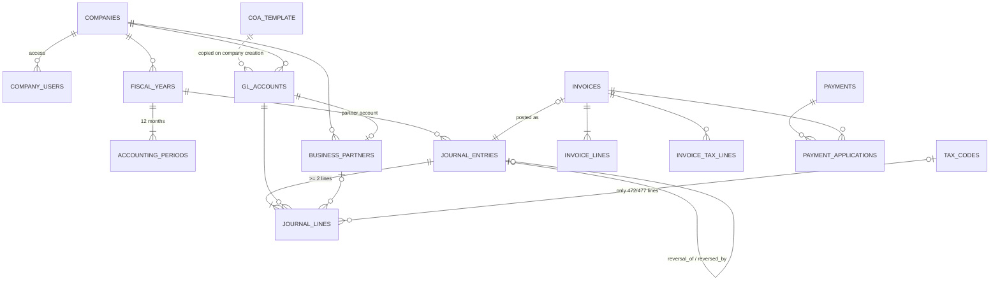

# Modelo de datos · Data model (v0.57.1)

Todo vive en el schema `erp` de PostgreSQL (Supabase), salvo el puente a Power BI, que está en el schema `bi`. Los
nombres van en inglés, al estilo de BC y SAP; el vocabulario está en [glosario.md](glosario.md).

- **Las reglas viven en la base de datos:** triggers, funciones y seguridad fila a fila (RLS). La web solo dibuja.
- **Cada función, en su versión vigente:** [`database/funciones/`](../database/funciones/README.md) (349 funciones,
  generado con `scripts/volcar-funciones.sh`). Este documento es el mapa; el detalle está allí y en cada ADR.
- **85 tablas y 23 vistas** en `erp`, agrupadas abajo por área, con la migración que crea cada una.
- Las equivalencias con BC y SAP son orientativas, para situarse *(pendiente de validar por Diosvely)*.

## El núcleo

Todo lo demás (inmovilizado, nóminas, préstamos, liquidaciones, cierre…) genera **asientos normales**: el diario es la
única fuente de los informes (ADR 0011).

## Tablas por área · Tables by area

### Empresas, usuarios y ejercicios
| Tabla | Qué guarda | Business Central | SAP | Migración |
|---|---|---|---|---|
| `companies` | Sociedad, sector, territorio fiscal, forma jurídica, modo de control, mes a mes, demo o temporal | Company | Company Code (T001) | 0001 |
| `company_users` | Acceso a cada empresa con su rol | User Permissions | Authorizations (PFCG) | 0001 |
| `app_profiles` | Perfil de la app: propietario o miembro, y cuántas empresas puede tener | User Setup | Roles | 0007 |
| `user_settings` | Idioma de la interfaz | User Settings | User Parameters | 0001 |
| `fiscal_years` / `accounting_periods` | Ejercicio y sus 12 meses (abiertos o cerrados) | Accounting Periods | Fiscal Year Variant / OB52 | 0001 |
| `guest_history` | Invitados de la demo, para limpiarlos | — | — | 0034 |
| `temp_settings` | Topes de las empresas temporales | — | — | 0072 |
| `ai_usage` / `ai_feedback` | Consumo diario de la IA y valoraciones | — | — | 0027 |

### Plan de cuentas, terceros y asientos
| Tabla | Qué guarda | Business Central | SAP | Migración |
|---|---|---|---|---|
| `coa_template` / `gl_accounts` | PGC 2007 (plantilla) y plan de cada empresa: cuentas `heading` y subcuentas `posting` | G/L Account | Chart of Accounts (SKA1 / SKB1) | 0002 |
| `business_partners` | Clientes, proveedores, acreedores y deudores, con su subcuenta, retención y días de pago | Customer / Vendor | Business Partner | 0003 |
| `journal_entries` / `journal_lines` | Asientos y apuntes: estado (borrador o contabilizado) y tipo (normal, apertura, regularización, cierre) | G/L Entries | BKPF / BSEG | 0004 |
| `import_batches` / `import_lines` | Diarios importados de Sage o Business Central | Configuration Packages | LSMW · Migration Cockpit | 0021 |

### Facturas, impuestos y cobros
| Tabla | Qué guarda | Business Central | SAP | Migración |
|---|---|---|---|---|
| `invoices` / `invoice_lines` / `invoice_tax_lines` | Facturas emitidas y recibidas, con sus bases y cuotas | Posted Sales / Purchase Invoices · VAT Entries | FB70 / FB60 · BSET | 0011 |
| `tax_codes` | Tipos de IVA / IGIC con su vigencia | VAT Product Posting Group | Tax Code (MWSKZ) | 0003 |
| `tax_setup` / `tax_settlement_setup` | La cuenta de cada tipo en la empresa y la configuración de la liquidación | VAT Posting Setup | OB40 | 0010 |
| `tax_settlements` | Liquidaciones trimestrales (303 / 420) | Calc. and Post VAT Settlement | RFUMSV00 | 0012 |
| `pro_rata` | Prorrata general y su regularización del 4T | — | — | 0020 |
| `withholding_codes` / `withholding_setup` | Retenciones de IRPF y su cuenta | — | Withholding Tax | 0018 |
| `withholding_rules` | Qué retención corresponde a cada tipo de tercero | — | — | 0033 |
| `payments` / `payment_applications` | Cobros y pagos aplicados a las facturas | Payment Journal · Apply Entries | F-28 / F-53 | 0035 |

### Fin de ejercicio y módulos
| Tabla | Qué guarda | Business Central | SAP | Migración |
|---|---|---|---|---|
| `year_closings` | Regularización, cierre y apertura de cada ejercicio | Close Income Statement | F.16 / FAGLGVTR | 0017 |
| `fixed_assets` / `asset_depreciations` / `depreciation_classes` | Inmovilizado: ficha y amortización | Fixed Assets | Asset Accounting (AA) | 0041 |
| `asset_events` | Deterioro, baja y venta del inmovilizado | Fixed Asset Ledger Entries | — | 0046 |
| `accruals` / `receivable_impairments` / `receivable_writeoffs` | Periodificaciones y deterioro de clientes | Deferrals | — | 0043 |
| `provisions` / `provision_movements` | Provisiones | — | — | 0045 |
| `inventory_counts` / `inventory_count_lines` | Inventario del cierre | Physical Inventory | — | 0047 |
| `employees` / `payroll_runs` / `payslips` / `ss_rates` / `ss_limits` | Nóminas con empleados ficticios y cotizaciones por año | (extensiones de nómina) | SAP HCM Payroll | 0049 |
| `corporate_tax_returns` / `corporate_tax_adjustments` / `corporate_tax_rates` | Impuesto sobre Sociedades del cierre | — | — | 0057 |
| `equity_operations` | Capital, reparto del resultado, dividendos y pérdidas | — | — | 0060 |
| `loans` / `loan_schedule` / `loan_events` | Préstamos a coste amortizado y leasing | — | Loans Management | 0062 |
| `grants` / `grant_events` | Subvenciones y su imputación | — | — | 0064 |

### Informes, reglas y estudio
| Tabla | Qué guarda | Migración |
|---|---|---|
| `balance_rules` | Naturaleza normal del saldo de cada cuenta (para los saldos al revés) | 0013 |
| `fs_lines` / `fs_mapping` | Partidas del Balance y la PyG (modelo PYMES) y a cuál va cada cuenta según el signo de su saldo | 0016 |
| `cf_lines` / `cf_mapping` | Estado de flujos de efectivo por los dos métodos | 0022 |
| `ratio_defs` | Ratios con su fórmula y su zona de referencia | 0023 |
| `valuation_rules` | Normas de valoración que usan las reglas | 0025 |
| `control_rules` / `audit_checks` | Cuentas controladas y comprobaciones del auditor | 0036 · 0037 |
| `concepts` / `sources` | Glosario y fuentes oficiales (la ontología) | 0038 · 0053 |
| `operations` / `exercises` / `exercise_attempts` | Catálogo de operaciones y supuestos autocorregidos | 0054 |
| `cases` / `case_expected` / `case_steps` / `case_entries` | Casos completos («Taller Atlántico SL») y sus 97 cifras | 0066 · 0067 |
| `pgc_groups` / `pgc_subgroups` / `pgc_accounts` / `pgc_cards` / `pgc_valuation_rules` / `pgc_principles` | PGC de estudio | 0071 |

### Tableros (v0.52.0 → v0.57.0)
| Tabla | Qué guarda | Migración |
|---|---|---|
| `dash_metrics` | Cada cifra una sola vez: partida del Balance o la PyG (con signo), grupo de cuentas, suma, resta, cociente, movimiento de tesorería, días, impuesto o movimiento de cuenta (45 métricas) | 0075 → 0082 |
| `dashboards` | Los seis tableros: Resumen de dirección, Rentabilidad, Tesorería, Impuestos, Ventas y gastos, y Calidad | 0075 |
| `dash_widgets` | Sus tarjetas: cifras, barras (por mes o por trimestre), líneas, tabla, ranking (con su fuente y cuántos) o lista de control | 0075 → 0084 |
| `quality_check_defs` | Los textos y la pantalla de cada fila de la lista de control | 0084 |

## Vistas · Views
Las 23 vistas `v_…` son las que lee la web, todas con `security_invoker`, para que se aplique la RLS de quien consulta:
`v_general_journal` (diario), `v_general_ledger` (mayor con `running_balance`), `v_tax_book` y `v_invoice_register`
(libro registro), `v_withholding_register`, `v_invoices`, `v_payments`, `v_fixed_assets`, `v_year_closings`…

## Puente a Power BI · schema `bi` (v0.50.0)
Modelo en estrella de solo lectura con las empresas demo, para el usuario `powerbi_reader`: `fact_apuntes`,
`fact_saldos_mes`, `fact_flujos`, `dim_cuenta`, `dim_empresa`, `dim_fecha`, `dim_linea`, `dim_ratio`, `puente_linea` y
`control_estados`. Guía en [`powerbi/GUIA.md`](powerbi/GUIA.md).

## Funciones principales · Main functions
Desde la web, con `supabase.rpc(...)`. La lista completa está en
[`database/funciones/`](../database/funciones/README.md).

| Área | Funciones |
|---|---|
| Asientos | `post_entry`, `reverse_entry`, `draft_ready`, `entries_list`, `close_month`, `reopen_month` |
| Informes | `trial_balance`, `financial_statement`, `fs_line_accounts`, `cash_flow_statement`, `financial_ratios`, `balance_anomalies` |
| Facturas e impuestos | `post_invoice`, `tax_settlement_calc`, `post_tax_settlement`, `tax_form_boxes`, `form_347`, `form_349` |
| Cobros y pagos | `open_items`, `aging` |
| Cierre | `year_closing_preview`, `close_fiscal_year`, `corporate_tax_calc` |
| Auditoría | `run_audit_checks`, `integrity_checks` |
| Tableros | `dashboard_data` (todo un tablero en una llamada), `quality_checks`, `fs_line_anomalies` |
| Casos | `create_case_company`, `case_compare` |

**Una sola regla por cifra:** los tableros leen las mismas funciones que los informes (`fs_classified_at`,
`cf_entry_cash`, `tax_accounts`…), así que cuadran al céntimo. Lo comprueban las pruebas de las fases 69 a 78.

## Convención de subcuentas (8 dígitos)

| Subcuenta | Uso |
|---|---|
| `4720 00 21` | IVA soportado 21 % · Input VAT 21 % |
| `4721 00 07` | IGIC soportado 7 % · Input IGIC 7 % |
| `4770 00 21` | IVA repercutido 21 % · Output VAT 21 % |
| `4771 00 07` | IGIC repercutido 7 % · Output IGIC 7 % |
| `4751 00 01` | Retenciones IRPF practicadas · Withholdings payable |

El PGC solo habla de IVA en las cuentas 472 y 477; en Canarias se usan esas mismas cuentas para el IGIC,
distinguiéndolo con subcuentas.
